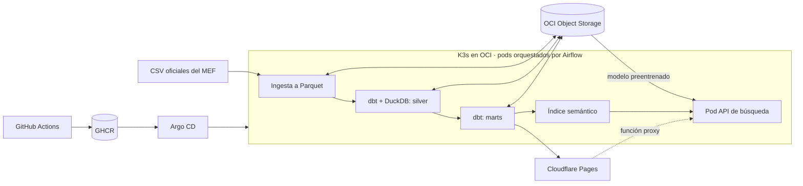

# Peru Budget Data Platform

Plataforma de datos que convierte los archivos oficiales de gasto público del Perú en una página que cualquier persona puede consultar: **Plata Pública Perú**.

Busca tu municipalidad, región o ministerio y mira cuánto dinero tuvo, cuánto gastó, en qué lo gastó y qué obras quedaron sin ejecutar.

> *End-to-end data platform that ingests Peru's official public spending files (2009 to today), models them with dbt and DuckDB, orchestrates daily runs with Airflow on K3s, and serves a citizen-facing site on Cloudflare Pages.*

## Arquitectura



| Capa | Herramientas | Responsabilidad |
|---|---|---|
| Ingesta | Python, DuckDB | Descarga reanudable, contrato de columnas, conteo CSV contra Parquet |
| Lago | OCI Object Storage | `bronze/`, `silver/`, `gold/` y `models/` |
| Transformación | dbt, DuckDB | Particiones por año, marts y pruebas de calidad |
| Orquestación | Airflow, KubernetesPodOperator | Corrida diaria y revisión mensual del histórico |
| Búsqueda | FastAPI, ONNX, modelo multilingüe | Encuentra "puesto de salud" al buscar "posta médica" |
| Publicación | Cloudflare Pages | Página estática sin servidor |
| Despliegue | GitHub Actions, GHCR, Argo CD | Imágenes multi-arquitectura fijadas por digest |

## Decisiones de ingeniería

- **Los años incompletos no se suman.** Los archivos oficiales de algunos años están truncados. El mart `mart_cobertura` exige los tres niveles de gobierno y excluye esos años de los totales.
- **Conciliación financiera.** Una prueba de dbt falla si la agregación crea o pierde un solo sol respecto al origen.
- **Bronze inmutable y sin tipar.** El dato se guarda tal como llegó. Los tipos se aplican en silver.
- **Reprocesamiento incremental.** Solo se recalculan los años cuyo archivo cambió.
- **Despliegue GitOps sin acceso a la VM.** El clúster es privado: Argo CD trae los cambios desde Git y CI nunca recibe credenciales de OCI.
- **El modelo se evaluó antes de usarlo.** Un clasificador por temas se descartó por acertar 52% frente a la clasificación oficial. La búsqueda semántica llegó a 94% de relevancia en una prueba de 10 consultas tras normalizar los nombres.

## Ejecutar en local

```bash
cp .env.example .env
make install
source .venv/bin/activate
set -a; source .env; set +a
gasto ingest --years 2024
gasto transform
gasto publish
```

La guía de producción está en [docs/deployment.md](docs/deployment.md).

## Interpretación responsable

Un porcentaje bajo de ejecución no prueba corrupción. Una obra puede estar empezando, tener problemas técnicos o haber recibido fondos a fin de año. Este es un proyecto independiente y no es un sitio oficial del Estado. Los datos provienen de [Datos Abiertos del MEF](https://datosabiertos.mef.gob.pe/).

## Licencia

Código bajo [licencia MIT](LICENSE).
