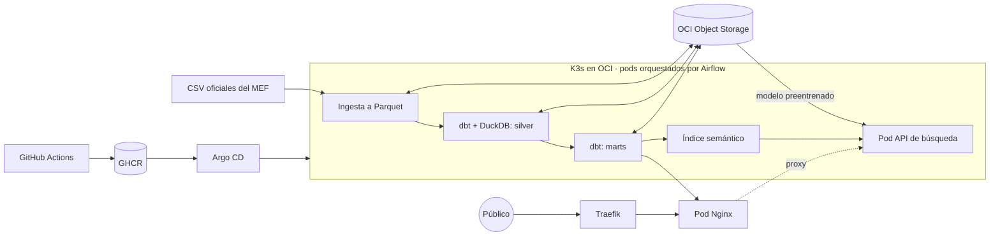

# Peru Budget Data Platform

Plataforma de datos que convierte los archivos oficiales de gasto público del Perú en una página que cualquier persona puede consultar: **Plata Pública Perú**.

Busca tu municipalidad, región o ministerio y mira cuánto dinero tuvo, cuánto gastó, en qué lo gastó y qué obras quedaron sin ejecutar.

**Página en vivo:** http://193.122.221.201/presupuesto/

| Métrica | Valor |
|---|---|
| Registros procesados | 150.4 millones |
| Periodo | 2009 a 2026, 18 años |
| CSV de origen | Más de 140 GB |
| Parquet en bronze | 4.4 GB |
| Entidades públicas | 2,154 |
| Obras en el buscador | 110,645 |

> *End-to-end data platform that ingests Peru's official public spending files (2009 to today), models them with dbt and DuckDB, orchestrates daily runs with Airflow on K3s, and serves a citizen-facing site from the cluster.*

## Arquitectura



| Capa | Herramientas | Responsabilidad |
|---|---|---|
| Ingesta | Python, DuckDB | Descarga reanudable, contrato de columnas, conteo CSV contra Parquet |
| Lago | OCI Object Storage | `bronze/`, `silver/`, `gold/` y `models/` |
| Transformación | dbt, DuckDB | Particiones por año, marts y pruebas de calidad |
| Orquestación | Airflow 3.4, KubernetesPodOperator | Corrida diaria y revisión mensual del histórico |
| Búsqueda | FastAPI, ONNX, modelo multilingüe | Busca por significado en 110,645 obras |
| Publicación | Nginx, Traefik | Página estática en un pod del clúster |
| Despliegue | GitHub Actions, GHCR, Argo CD | Imágenes multi-arquitectura fijadas por digest |

## Modelo de IA

El buscador de obras usa un modelo preentrenado multilingüe: [`paraphrase-multilingual-MiniLM-L12-v2`](https://huggingface.co/sentence-transformers/paraphrase-multilingual-MiniLM-L12-v2), en formato ONNX cuantizado.

- **Qué hace:** convierte el nombre de cada obra en un vector de 384 dimensiones. Así, "posta médica" encuentra "puesto de salud" aunque las palabras no coincidan.
- **Dónde corre:** en un pod con FastAPI y solo CPU, compatible con ARM64. No usa GPU ni servicios de pago.
- **Cómo se distribuye:** el paquete de 221 MB vive en el bucket. El pod lo descarga al iniciar y verifica su SHA-256, lo que mantiene ligera la imagen Docker.
- **Evaluación:** en 10 consultas de ejemplo, la relevancia de los 10 primeros resultados subió de 44% a 94% al pasar los textos a minúsculas y quitar la ubicación. Es una prueba pequeña, medida con palabras clave.
- **Descartado:** un clasificador de obras por tema con este modelo coincidió solo 52% con la clasificación oficial, que además ya existe. No llegó a producción.

El modelo no genera texto: solo ordena obras por parecido.

## Modelos de datos

Arquitectura medallion con 10 modelos dbt sobre DuckDB.

| Capa | Modelo | Contenido |
|---|---|---|
| Silver | `stg_gasto` | Tipos, limpieza y marca de filas inválidas |
| Silver | `fct_gasto` | Gasto por año, mes, entidad, función, genérica, proyecto, región y fuente |
| Silver | `fct_cobertura` | Evidencia de completitud del archivo de cada año |
| Gold | `mart_cobertura` | Clasifica cada año como completo o incompleto |
| Gold | `mart_entidad` | Directorio de entidades para el buscador |
| Gold | `mart_entidad_anual` | Presupuesto y ejecución por entidad y año |
| Gold | `mart_entidad_funcion` | En qué gastó cada entidad |
| Gold | `mart_proyecto` | Presupuesto frente a ejecución por obra |
| Gold | `mart_region_anual` | Gasto dentro de cada departamento |
| Gold | `mart_nacional_funcion` | Distribución nacional del gasto |

El bucket privado de OCI Object Storage se organiza así:

```text
gasto-publico-peru/
├── bronze/   Parquet sin tipar, tal como lo publica el MEF
├── silver/   Hechos tipados y evidencia de cobertura, por año
├── gold/     Marts en Parquet e índice de búsqueda
└── models/   Modelo preentrenado
```

## Calidad de los datos

Problemas reales encontrados en las fuentes oficiales:

- **2016 y 2017 están truncados.** Los archivos no incluyen el gobierno nacional y su última fila está cortada. Se conservan en el lago, pero la página no los suma ni los compara.
- **2007 y 2008 usan otro clasificador** y no traen códigos de proyecto. El histórico comparable empieza en 2009.
- **Registros con saltos de línea entre comillas.** La conversión usa un lector no paralelo y compara el conteo de filas contra el CSV.

Como verificación externa, el presupuesto inicial calculado para 2014 (S/ 118,934 millones), 2015 (S/ 130,621 millones), 2024 (S/ 240,806 millones) y 2025 (S/ 251,801 millones) coincide con las leyes de presupuesto de esos años.

## Limitaciones

- El clúster tiene un solo nodo, así que una caída de la VM interrumpe la página y el buscador. El lago permanece en el bucket.
- La página se sirve por HTTP porque aún no tiene dominio propio.
- La VM tiene poco disco libre y cada CSV anual ocupa hasta 10 GB. Por eso la carga inicial se procesó fuera del clúster y los DAGs de Airflow están en pausa hasta ampliar el almacenamiento.
- Un mes se considera con datos cuando el MEF ya lo publicó, por lo que el año en curso siempre es parcial.

## Decisiones de ingeniería

- **Los años incompletos no se suman.** `mart_cobertura` exige los tres niveles de gobierno y excluye de los totales los años que no los tienen.
- **Conciliación financiera.** Una prueba de dbt falla si la agregación crea o pierde un solo sol respecto al origen.
- **Bronze inmutable y sin tipar.** El dato se guarda tal como llegó. Los tipos se aplican en silver.
- **Reprocesamiento incremental.** Solo se recalculan los años cuyo archivo cambió.
- **Despliegue GitOps sin acceso a la VM.** El clúster es privado: Argo CD trae los cambios desde Git y CI nunca recibe credenciales de OCI.

## Ejecutar en local

```bash
cp .env.example .env
make install
source .venv/bin/activate
set -a; source .env; set +a
gasto ingest --years 2024
gasto transform
gasto publish
```

La guía de producción está en [docs/deployment.md](docs/deployment.md).

## Interpretación responsable

Un porcentaje bajo de ejecución no prueba corrupción. Una obra puede estar empezando, tener problemas técnicos o haber recibido fondos a fin de año. Este es un proyecto independiente y no es un sitio oficial del Estado. Los datos provienen de [Datos Abiertos del MEF](https://datosabiertos.mef.gob.pe/).

## Licencia

Código bajo [licencia MIT](LICENSE).
