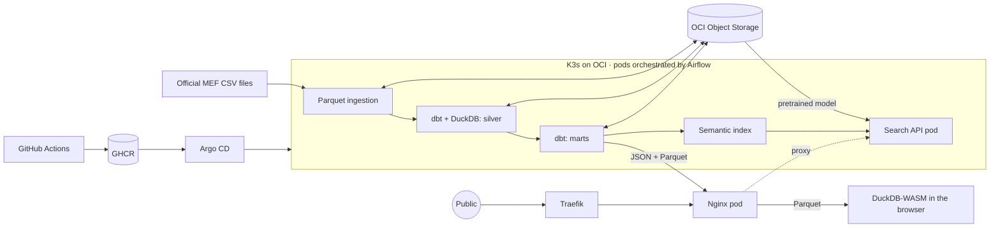

# Peru Spend Tracker

Data platform that turns Peru's official public spending files into a website anyone can use.

Search for a municipality, region, or ministry and see how much money it had, how much it spent, what it spent it on, how it compares with similar entities, how much it spent per resident, and which public works were left unfinished. A SQL console next to every chart runs DuckDB in the browser against the same marts, so anyone can check the numbers or ask their own questions. The site is available in Spanish and English.

**Live site:** https://peru-spend-tracker.renzoaguilar.dev

| Metric | Value |
|---|---|
| Records processed | 150.4 million |
| Period | 2009 to 2026, 18 years |
| Source CSV | More than 140 GB |
| Parquet in bronze | 4.4 GB |
| Public entities | 2,154 |
| Public works in search | 110,645 |

## Highlights

- Built an end-to-end ELT pipeline in Python and SQL that processes 150.4M official spending records from Peru's Ministry of Economy and Finance (2009–2026), reducing 140+ GB of CSV to 4.4 GB of Parquet and serving 2,154 public entities through a public website.
- Modeled a medallion warehouse on DuckDB with 14 dbt models, an INEI population seed, and SQL data-quality tests, using OCI Object Storage as the data lake; added schema contracts plus row-count and financial reconciliation, which flagged truncated official files for 2016–2017 and matched enacted budget laws for 2014, 2015, 2024, and 2025.
- Shipped an in-browser SQL console with DuckDB-WASM that queries the published gold marts as Parquet over HTTP range requests, with a CodeMirror editor, schema autocomplete, EXPLAIN plans, automatic charts, CSV export, shareable query links, and every chart on the page linked to the query that produces it, all under a strict Content Security Policy.
- Matched 1,694 of 1,698 district municipalities to INEI population data by fuzzy name matching (Jaro-Winkler) inside dbt, enabling spending per resident and peer comparisons by budget size.
- Orchestrated incremental loads with Apache Airflow on K3s, with task dependencies, retries, and stage-level recovery; shipped ARM64 images built on native ARM runners through GitHub Actions and Argo CD, and added semantic search across 110,645 public works using a multilingual ONNX model.

## Architecture



| Layer | Tools | Responsibility |
|---|---|---|
| Ingestion | Python, DuckDB | Resumable downloads, column contract, CSV-to-Parquet row counts |
| Data lake | OCI Object Storage | `bronze/`, `silver/`, `gold/`, and `models/` |
| Transformation | dbt, DuckDB | Yearly partitions, marts, and quality tests |
| Orchestration | Airflow 3.4, KubernetesPodOperator | Daily runs and a monthly review of the full history |
| Search | FastAPI, ONNX, multilingual model | Searches 110,645 public works by meaning |
| Publishing | Nginx, Traefik, Cloudflare | Static website in a cluster pod, served over HTTPS on its own domain |
| SQL console | DuckDB-WASM, Parquet | Read-only queries over the gold marts, run entirely in the visitor's browser |
| Deployment | GitHub Actions, GHCR, Argo CD | ARM64 images built on native runners, pinned by digest |
| Monitoring | GitHub Actions, webhooks | Site checks every 3 hours that open an issue, and DAG failure alerts |

## AI model

The public works search uses a pretrained multilingual model: [`paraphrase-multilingual-MiniLM-L12-v2`](https://huggingface.co/sentence-transformers/paraphrase-multilingual-MiniLM-L12-v2), in quantized ONNX format.

- **What it does:** converts each project name into a 384-dimension vector, so "posta médica" (clinic) finds "puesto de salud" (health post) even though the words differ.
- **Where it runs:** in a CPU-only FastAPI pod that is ARM64-compatible, with no GPU or paid services.
- **How it is distributed:** the 221 MB package lives in the bucket. The pod downloads it at startup and verifies its SHA-256, which keeps the Docker image small.
- **Evaluation:** across 10 sample queries, top-10 relevance rose from 44% to 94% after lowercasing the text and removing locations. This is a small test, measured with keywords.
- **Discarded:** a topic classifier built with this model matched the official classification only 52% of the time, and that classification already exists. It did not reach production.

The model does not generate text. It only ranks public works by similarity.

## Data models

A medallion architecture with 14 dbt models on DuckDB, plus a seed with INEI population projections (2018–2026).

| Layer | Model | Content |
|---|---|---|
| Silver | `stg_gasto` | Types, cleaning, and invalid-row flags |
| Silver | `fct_gasto` | Spending by year, month, entity, function, generic category, project, region, and funding source |
| Silver | `fct_cobertura` | Evidence of how complete each year's file is |
| Gold | `mart_cobertura` | Classifies each year as complete or incomplete |
| Gold | `mart_entidad` | Entity directory for the search box |
| Gold | `mart_entidad_anual` | Budget and execution by entity and year |
| Gold | `mart_entidad_funcion` | What each entity spent on |
| Gold | `mart_proyecto` | Budget versus execution for each public work |
| Gold | `mart_region_anual` | Spending within each department |
| Gold | `mart_nacional_funcion` | National spending distribution |
| Gold | `mart_entidad_territorio` | INEI district, province, or department served by each entity |
| Gold | `mart_entidad_pares` | Each entity against others of the same type and budget decile |
| Gold | `mart_mensual` | Cumulative spending through the year, by month |
| Gold | `mart_fuente` | Budget and spending by funding source |

The private OCI Object Storage bucket is organized as follows:

```text
gasto-publico-peru/
├── bronze/   Untyped Parquet, exactly as published by the ministry
├── silver/   Typed facts and coverage evidence, by year
├── gold/     Marts in Parquet and the search index
└── models/   Pretrained model
```

## Data quality

Real problems found in the official sources:

- **2016 and 2017 are truncated.** The files omit the national government and their last row is cut off. They remain in the lake, but the website does not add them up or compare them.
- **2007 and 2008 use a different classifier** and have no project codes. Comparable history starts in 2009.
- **Records contain line breaks inside quotes.** The conversion uses a non-parallel reader and compares the row count against the CSV.

As an external check, the initial budget calculated for 2014 (S/ 118,934 million), 2015 (S/ 130,621 million), 2024 (S/ 240,806 million), and 2025 (S/ 251,801 million) matches the budget laws for those years.

## Limitations

- The cluster has a single node, so a VM outage takes down the website and search. The lake remains in the bucket.
- The initial load was processed outside the cluster because each yearly CSV takes up to 10 GB. The VM disk has since been expanded to 100 GB; the Airflow DAGs run once the bucket credentials are stored in the cluster.
- A month counts as having data once the ministry has published it, so the current year is always partial.

## Engineering decisions

- **Incomplete years are not added up.** `mart_cobertura` requires all three levels of government and excludes years without them from totals.
- **Financial reconciliation.** A dbt test fails if aggregation creates or loses a single sol compared with the source.
- **Untyped bronze.** Data is stored as it arrived, and types are applied in silver. When the ministry republishes a year, the new file replaces the previous version.
- **Incremental reprocessing.** Only years whose file changed are recalculated.
- **GitOps deployment without VM access.** The cluster is private: Argo CD pulls changes from Git and CI never receives OCI credentials.

## Run locally

```bash
cp .env.example .env
make install
source .venv/bin/activate
set -a; source .env; set +a
gasto ingest --years 2024
gasto transform
gasto publish
```

The production guide is in [docs/deployment.md](docs/deployment.md), written in Spanish.

## Responsible interpretation

A low execution rate does not prove corruption. A public work may be just starting, have technical problems, or have received funds at the end of the year. This is an independent project and not an official government website. The data comes from [Datos Abiertos del MEF](https://datosabiertos.mef.gob.pe/).

## License

Code released under the [MIT License](LICENSE).
